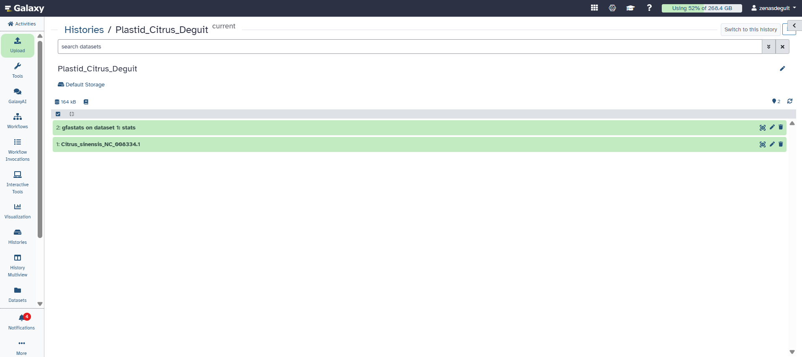

# Characterization of the Plastid Genome of Citrus sinensis

**Course:** Cell and Molecular Biology Laboratory  
**Student:** Deguit, Zenas Charis C. 
**Course/Section:** B 
**Genus:** *Citrus*  
**Selected Species:** *Citrus sinensis* (Sweet Orange)  
**Family:** Rutaceae  
**NCBI Accession:** NC_008334.1  
**Database:** NCBI RefSeq  
**Bioinformatics Platform:** Galaxy (usegalaxy.org)

---

## 1. Introduction

Plastid genomes, also known as plastomes, contain genetic information essential for various cellular processes, particularly photosynthesis and plastid gene expression. In many flowering plants, the chloroplast genome has a conserved quadripartite organization consisting of a Large Single-Copy (LSC) region, a Small Single-Copy (SSC) region, and two Inverted Repeat (IR) regions.

This activity focused on the characterization of the complete chloroplast genome of *Citrus sinensis*, commonly known as sweet orange. The genome was retrieved from the National Center for Biotechnology Information (NCBI) and analyzed using Galaxy to determine its sequence length, GC content, and other basic genomic characteristics. The annotated GenBank record and published literature were also examined to identify important genes and structural features.

---

## 2. Objectives

The objectives of this activity were to:

1. Retrieve and verify a complete annotated chloroplast genome from NCBI.
2. Analyze the genome sequence using Galaxy.
3. Determine the genome length, GC content, and basic sequence statistics.
4. Characterize the LSC, SSC, and IR regions.
5. Identify annotated protein-coding genes, rRNA genes, and tRNA genes.
6. Examine introns, duplicated genes, and other notable genomic features.
7. Compare the characteristics of plastid and mitochondrial genomes.
8. Document the analysis, results, and interpretations in GitHub.

---

## 3. Genome Data Source

The complete chloroplast genome of *Citrus sinensis* was obtained from the NCBI RefSeq database.

### Genome Information

| Information | Details |
|---|---|
| Scientific Name | *Citrus sinensis* (L.) Osbeck |
| Common Name | Sweet Orange |
| Family | Rutaceae |
| Database | NCBI RefSeq |
| Accession/Version | NC_008334.1 |
| Genome Type | Complete Chloroplast Genome |
| Genome Length | 160,129 bp |
| GC Content | 38.48% |
| GenBank LOCUS Topology | Linear |
| Genome Organization | Quadripartite |

**NCBI Record:**  
https://www.ncbi.nlm.nih.gov/nuccore/NC_008334.1

### Downloaded Genome Files

The following files were downloaded from NCBI:

- [Complete Chloroplast Genome (FASTA)](data/Citrus_sinensis_NC_008334.1.fasta)
- [Annotated Chloroplast Genome (GenBank)](data/Citrus_sinensis_NC_008334.1.gb)

The FASTA file was used for sequence-statistics analysis in Galaxy, while the GenBank file was used to examine annotated genes and other genomic features.

---

## 4. Galaxy Workflow

The complete chloroplast genome was analyzed using the Galaxy bioinformatics platform.

**Galaxy Website:** https://usegalaxy.org/

**Galaxy History Name:** `Plastid_Citrus_Deguit`

**Tool Used:** gfastats

### Analysis Procedure

1. Retrieved the complete chloroplast genome of *Citrus sinensis* from NCBI.
2. Downloaded the genome sequence in FASTA format and its annotations in GenBank format.
3. Logged in to the Galaxy platform using a personal account.
4. Created a new history named `Plastid_Citrus_Deguit`.
5. Uploaded the FASTA file containing the complete chloroplast genome.
6. Confirmed that Galaxy successfully recognized the uploaded dataset.
7. Used the gfastats tool to calculate basic genome statistics.
8. Recorded the genome length, scaffold and contig counts, GC content, and nucleotide composition.
9. Compared the Galaxy results with the information provided in the NCBI record.
10. Examined the annotated genome to identify its gene content and structural features.

---

## 5. Galaxy Sequence Statistics

The gfastats tool successfully analyzed the complete chloroplast genome.

### Table 1. Galaxy gfastats Results

| Parameter | Result |
|---|---:|
| Total Genome Length | 160,129 bp |
| GC Content | 38.48% |
| AT Content | 61.52% |
| Number of Scaffolds | 1 |
| Number of Contigs | 1 |
| Scaffold N50 | 160,129 bp |
| Contig N50 | 160,129 bp |
| Number of Gaps | 0 |
| Adenine (A) | 48,780 |
| Cytosine (C) | 31,405 |
| Guanine (G) | 30,216 |
| Thymine (T) | 49,728 |

### Interpretation

The Galaxy gfastats analysis showed that the *Citrus sinensis* chloroplast genome consists of one continuous sequence measuring 160,129 bp, with a GC content of 38.48%. The analysis identified one scaffold and one contig, with no reported assembly gaps. The GC content also indicates that the genome contains a higher proportion of adenine and thymine than guanine and cytosine.

### Figure 1. Galaxy Sequence Statistics



**Figure 1.** Galaxy gfastats analysis of the complete *Citrus sinensis* chloroplast genome (NC_008334.1), showing the successful sequence-statistics output.

---

## 6. Plastid Genome Organization

The chloroplast genome of *Citrus sinensis* exhibits the typical quadripartite organization found in many flowering plants.

It consists of a Large Single-Copy region, a Small Single-Copy region, and two Inverted Repeat regions.

### Table 2. Chloroplast Genome Regions

| Genome Region | Size (bp) |
|---|---:|
| Large Single-Copy (LSC) | 87,744 |
| Small Single-Copy (SSC) | 18,393 |
| Inverted Repeat A (IRa) | 26,996 |
| Inverted Repeat B (IRb) | 26,996 |
| **Total Genome Length** | **160,129** |

The LSC region is the largest portion of the genome, while the two inverted repeats contain duplicated genes. This organization is consistent with the published genome characterization by Bausher et al. (2006).

---

## 7. Annotated Gene Content

The original study of the *Citrus sinensis* chloroplast genome reported 133 genes, including genes involved in photosynthesis, transcription, translation, and other plastid functions.

### Table 3. Published Gene Inventory

| Gene Category | Reported Number |
|---|---:|
| Total Genes | 133 |
| Protein-Coding Genes | 89 |
| Distinct tRNA Genes | 30 |
| Distinct rRNA Genes | 4 |
| Genes Containing Introns | 17 |

**Note:** The published gene categories use different counting conventions, especially for genes duplicated within the inverted repeats. The current GenBank file contains 140 gene feature entries, 87 CDS entries, 45 tRNA entries, and 8 rRNA entries. These annotation-feature counts are reported separately from the published gene inventory.

### Important Gene Groups

The chloroplast genome contains the following functional groups:

- **Photosystem I:** psa genes
- **Photosystem II:** psb genes
- **ATP Synthase:** atp genes
- **Cytochrome b6f Complex:** pet genes
- **Carbon Fixation:** rbcL
- **RNA Polymerase:** rpo genes
- **Ribosomal Proteins:** rpl and rps genes
- **Ribosomal RNA:** rrn genes
- **Transfer RNA:** trn genes
- **Other Functional Genes:** matK, clpP, accD, and ycf genes

### Notable Genome Features

Several important genomic features were identified:

1. The genome contains intron-bearing genes, including atpF, rpoC1, clpP, ycf3, and rps12.
2. The rps12 gene undergoes trans-splicing.
3. Several genes are duplicated within the inverted-repeat regions.
4. The original study reported the absence of the infA gene.
5. A duplicated rpl22 sequence in the IRb region contains premature stop codons.

These features provide information about chloroplast gene expression, RNA processing, and plastid genome evolution.

For the detailed gene tables, descriptions, and interpretations, see the complete characterization results below.

**[View Complete Genome Characterization Results](results/genome_characterization.md)**

---

## 8. Plastid and Mitochondrial Genome Comparison

Plastid and mitochondrial genomes are both organellar genomes with bacterial evolutionary origins. Both contain genes involved in essential cellular processes and depend on nuclear-encoded proteins for many functions.

However, plastid genomes are primarily associated with photosynthesis and plastid gene expression, whereas mitochondrial genomes are associated with cellular respiration and oxidative phosphorylation.

Plastid genomes generally have a more conserved organization among flowering plants, while plant mitochondrial genomes frequently display greater structural variation and recombination-mediated rearrangements.

A detailed comparison of plastid and mitochondrial genomes, including inheritance, genome size, gene content, mutation patterns, and research applications, is provided in the laboratory report.

---

## 9. Biological and Research Significance

Plastid genomes are valuable in molecular biology, plant systematics, evolutionary studies, and conservation genetics.

Their relatively small size, conserved gene content, and frequent uniparental inheritance make them useful for comparative genomics and phylogenetic analysis. Plastid genes such as rbcL and matK are also widely used for plant identification and DNA barcoding.

However, plastid genomes represent only a portion of a plant's genetic information. Nuclear genomic analysis is often necessary to investigate complex traits, biparental inheritance, and nuclear gene regulation.

The complete chloroplast genome of *Citrus sinensis* provides a valuable reference for investigating plastid genome organization and evolutionary relationships among Citrus species and other flowering plants.

---

## 10. Final Laboratory Report

The completed laboratory report contains:

- Answers to Questions 1–10
- Genome structure and gene content analysis
- Functional descriptions of selected plastid genes
- RNA and RNA-processing features
- Pseudogenes, gene losses, and duplications
- Galaxy sequence-statistics interpretation
- Plastid versus mitochondrial genome comparison table
- Advantages and limitations of plastid genomes
- Conclusion and references

**[View Complete Laboratory Report](report/Plastid_Genome_Report.md)**

---

## 11. Repository Organization

The GitHub repository is organized as follows:

```text
Deguit_Citrus_Plastid_Genome_CMB/
│
├── README.md
│
├── data/
│   ├── Citrus_sinensis_NC_008334.1.fasta
│   ├── Citrus_sinensis_NC_008334.1.gb
│   └── README.md
│
├── results/
│   └── genome_characterization.md
│
├── figures/
│   ├── 01_galaxy_statistics.png
│   └── README.md
│
└── report/
    └── Plastid_Genome_Report.md
```

---

## 12. Reproducibility

The analysis can be reproduced by following these steps:

1. Visit NCBI Nucleotide and search for accession NC_008334.1.
2. Download the complete chloroplast genome of *Citrus sinensis* in FASTA and GenBank formats.
3. Open Galaxy at https://usegalaxy.org/.
4. Create a new history and upload the FASTA sequence.
5. Use the gfastats tool to calculate sequence statistics.
6. Record the genome length, GC content, scaffold count, contig count, and other statistics.
7. Examine the GenBank annotations to identify genes, introns, and other features.
8. Consult the original chloroplast genome publication for structural information.
9. Compare the results with the tables and interpretations provided in this repository.

The genome files, statistics, and laboratory report are provided to allow other students to review and reproduce the analysis.

---

## 13. Conclusion

The characterization of the *Citrus sinensis* chloroplast genome revealed a complete plastid genome measuring 160,129 bp, with a GC content of 38.48%. Galaxy gfastats analysis confirmed that the genome was represented by one continuous sequence without reported assembly gaps.

The genome exhibits a typical quadripartite organization and contains genes associated with photosynthesis, ATP production, carbon fixation, transcription, translation, and RNA processing. Several notable features, including intron-containing genes, duplicated genes, and reported gene loss, provide additional information about chloroplast genome evolution.

Overall, this activity demonstrated how NCBI, Galaxy, and genomic annotations can be integrated to characterize a plastid genome and understand its biological and evolutionary significance.

---

## 14. References

1. Bausher, M. G., Singh, N. D., Lee, S. B., Jansen, R. K., & Daniell, H. (2006). The complete chloroplast genome sequence of Citrus sinensis (L.) Osbeck var 'Ridge Pineapple': Organization and phylogenetic relationships to other angiosperms. *BMC Plant Biology, 6*, 21.  
  https://link.springer.com/article/10.1186/1471-2229-6-21

2. National Center for Biotechnology Information. *Citrus sinensis* chloroplast, complete genome (NC_008334.1).  
   https://www.ncbi.nlm.nih.gov/nuccore/NC_008334.1

3. Galaxy Project. Galaxy Main.  
   https://usegalaxy.org/

4. Galaxy Training Network.  
   https://training.galaxyproject.org/
